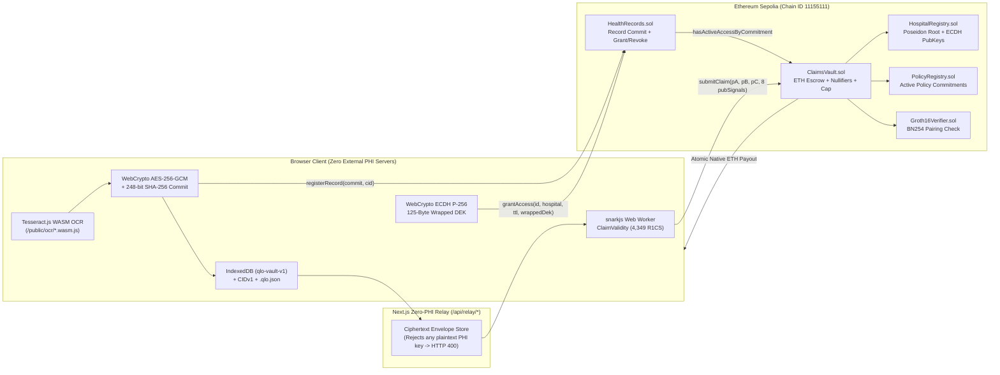
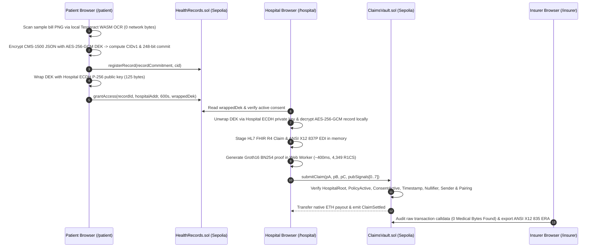

# Qlo Protocol — Zero-Knowledge Health Insurance Claims & Patient-Sovereign Medical Records

**Qlo is a decentralized zero-knowledge health insurance clearinghouse and patient-sovereign encrypted medical record vault live on Ethereum Sepolia (`Chain ID 11155111`).**

Hospitals prove clinical claim validity, policy coverage, hospital accreditation, and cumulative annual coverage limits in **sub-second Groth16 BN254 zero-knowledge proofs (`4,349` R1CS constraints, `8` frozen public signals)** inside a browser Web Worker—receiving atomic native ETH payouts from `ClaimsVault.sol` while exposing **0 bytes of Protected Health Information (PHI)** on-chain. Patients scan medical bills locally via **100% browser-local Tesseract.js WASM OCR**, encrypt records in **WebCrypto AES-256-GCM**, anchor 248-bit SHA-256 commitments + IPFS CIDv1 digests on-chain, and grant time-bound, revocable **ECDH P-256** wrapped Data Encryption Keys (DEKs) to accredited hospitals.

---

## Table of Contents

1. [One-Command Start & Shutdown](#1-one-command-start--shutdown)
2. [Live Ethereum Sepolia Deployment & Proof of Execution](#2-live-ethereum-sepolia-deployment--proof-of-execution)
3. [Included Sample Medical Bills (PNG Invoices & JSON)](#3-included-sample-medical-bills-png-invoices--json)
4. [System Architecture & End-to-End Cryptographic Flow](#4-system-architecture--end-to-end-cryptographic-flow)
5. [Protocol Modules & 3-Minute Demo Walkthrough](#5-protocol-modules--3-minute-demo-walkthrough)
6. [Zero-Knowledge Circuit Specification (`ClaimValidity.circom`)](#6-zero-knowledge-circuit-specification-claimvaliditycircom)
7. [Client-Side Cryptography, Storage & Healthcare Standards](#7-client-side-cryptography-storage--healthcare-standards)
8. [Prior Art Benchmark: Qlo vs. VeriSure (ETHDenver 2025)](#8-prior-art-benchmark-qlo-vs-verisure-ethdenver-2025)
9. [Verification, Testing & Security Audit Matrix](#9-verification-testing--security-audit-matrix)
10. [Repository Structure & Documentation Index](#10-repository-structure--documentation-index)

---

## 1. One-Command Start & Shutdown

Qlo includes automated lifecycle scripts ([`start.ps1`](start.ps1), [`stop.ps1`](stop.ps1), [`start.bat`](start.bat), [`stop.bat`](stop.bat), and root `pnpm` scripts) that verify dependencies, generate the 5 sample medical bill PNG/JSON assets if missing, build the production bundle if needed, launch the server in the background, and verify `/api/health`.

### Spin Up the Entire Project

```powershell
# Option A: PowerShell script (recommended)
.\start.ps1

# Option B: Root pnpm command
pnpm start

# Option C: Double-click or run from CMD
start.bat
```

**Optional Flags for `.\start.ps1`:**
- `.\start.ps1 -OpenBrowser` — Automatically opens `http://localhost:3000` in your default browser once `/api/health` is ready.
- `.\start.ps1 -Rebuild` — Forces a fresh `next build` before starting the production server.
- `.\start.ps1 -Dev` — Starts Next.js in hot-reload development mode (`next dev`) on port `3000`.
- `.\start.ps1 -LocalAnvil` — Also spins up a local Foundry `anvil` EVM node on `http://127.0.0.1:8545`.
- `.\start.ps1 -Port 3005` — Runs the web server on a custom port.

### Shut Down All Services Cleanly

```powershell
# Option A: PowerShell script (stops tracked PIDs + frees port 3000 & 8545)
.\stop.ps1

# Option B: Stop and wipe temporary local Zero-PHI relay cache
.\stop.ps1 -CleanCache

# Option C: Root pnpm command or CMD batch file
pnpm stop
stop.bat
```

---

## 2. Live Ethereum Sepolia Deployment & Proof of Execution

All 5 Solidity `0.8.28` contracts are deployed on **Ethereum Sepolia (`Chain ID 11155111`, Block `12194573`)** and verified **`5 / 5 exact_match`** on Sourcify.
- **Pinned Groth16 `.zkey` SHA-256 Digest:** `7f26163076e3dcc5e61175e96fb6ce8a95b36dac8ba27c7e7ee5edcee4771746`

### Verified Smart Contract Registry (`deployments/sepolia.json`)

| Contract | Sepolia Address | Role & Security Controls | Verification Links |
| :--- | :--- | :--- | :--- |
| **`Groth16Verifier`** | `0x587FB82b3429d9Be80e23791809A92DAD352D019` | On-chain BN254 pairing check for `uint256[8] pubSignals` | [Sourcify](https://repo.sourcify.dev/contracts/full_match/11155111/0x587FB82b3429d9Be80e23791809A92DAD352D019) · [Etherscan](https://sepolia.etherscan.io/address/0x587FB82b3429d9Be80e23791809A92DAD352D019) |
| **`HospitalRegistry`** | `0xCf150397a7416D54c3828ffaC1B808a5C51B563D` | `Ownable2Step` Poseidon depth-6 `hospitalRoot` + hospital ECDH P-256 keys | [Sourcify](https://repo.sourcify.dev/contracts/full_match/11155111/0xCf150397a7416D54c3828ffaC1B808a5C51B563D) · [Etherscan](https://sepolia.etherscan.io/address/0xCf150397a7416D54c3828ffaC1B808a5C51B563D) |
| **`PolicyRegistry`** | `0xc37c6A5e705B9aa9eB2680aBb2A72Ebf9080ebCF` | Anchors insurer-signed opaque `Poseidon(6)` policy commitments | [Sourcify](https://repo.sourcify.dev/contracts/full_match/11155111/0xc37c6A5e705B9aa9eB2680aBb2A72Ebf9080ebCF) · [Etherscan](https://sepolia.etherscan.io/address/0xc37c6A5e705B9aa9eB2680aBb2A72Ebf9080ebCF) |
| **`HealthRecords`** | `0x547273d15522AA461af233e5b4d7abb70D0bD8ce` | Stores 248-bit record commitments, CIDv1, time-bound ECDH grants & instant revoke | [Sourcify](https://repo.sourcify.dev/contracts/full_match/11155111/0x547273d15522AA461af233e5b4d7abb70D0bD8ce) · [Etherscan](https://sepolia.etherscan.io/address/0x547273d15522AA461af233e5b4d7abb70D0bD8ce) |
| **`ClaimsVault`** | `0xB170D66d32C26168A56516d0aDb464B7762cC559` | `Pausable`, `ReentrancyGuard` ETH escrow, 8-signal verifier, nullifier & cap ledger | [Sourcify](https://repo.sourcify.dev/contracts/full_match/11155111/0xB170D66d32C26168A56516d0aDb464B7762cC559) · [Etherscan](https://sepolia.etherscan.io/address/0xB170D66d32C26168A56516d0aDb464B7762cC559) |

### Mined Live Sepolia Proof-of-Execution Transactions

- **Record #1 Registration (`HealthRecords.registerRecord`):** [`0x742035b943904c6bdcde1a6ceeba505efa75b2fccaba2d549860ae5fb350494e`](https://sepolia.etherscan.io/tx/0x742035b943904c6bdcde1a6ceeba505efa75b2fccaba2d549860ae5fb350494e)
- **Time-Bound Consent Grant (`HealthRecords.grantAccess`, 600s + 125-byte ECDH Wrapped DEK):** [`0x155888e6d36bb9849b1f9e066d20e4a10902ed618858d1de666dd12ba0c93cb1`](https://sepolia.etherscan.io/tx/0x155888e6d36bb9849b1f9e066d20e4a10902ed618858d1de666dd12ba0c93cb1)
- **Groth16 Claim Settlement (`ClaimsVault.submitClaim`, `0.005 ETH`, `574ms` prove, `0` PHI bytes):** [`0xf8cb4e31169eac006b4c5dd0a69fa763de7b9ddb79a7cd25419062ead7aa2ed0`](https://sepolia.etherscan.io/tx/0xf8cb4e31169eac006b4c5dd0a69fa763de7b9ddb79a7cd25419062ead7aa2ed0)
- **Escrow Reserve Top-Up (`ClaimsVault.depositEscrow`, `0.0200 ETH` active reserve):** [`0x2c0fd149ea3059a677a704bea0dbbb711b02caa9055a94c73962a313a1fd0e8d`](https://sepolia.etherscan.io/tx/0x2c0fd149ea3059a677a704bea0dbbb711b02caa9055a94c73962a313a1fd0e8d)

---

## 3. Included Sample Medical Bills (PNG Invoices & JSON)

Five synthetic CMS-1500 hospital invoices are bundled in [`apps/web/public/samples/`](apps/web/public/samples) and wired directly into the **Records Vault (`/patient`)** UI. You can click **OCR Scan** on any bill to watch browser-local Tesseract.js WASM OCR extract all CMS-1500 fields from the PNG image, click **Load** to populate instantly, or download the `.png` / `.json` files to test manual upload:

| Invoice ID | PNG & JSON Files | Facility & Scenario | Policy ID | ICD-10 | CPT | Amount | Expected Protocol Outcome |
| :--- | :--- | :--- | :--- | :--- | :--- | :--- | :--- |
| `INV-MCC-2026-0042` | [`bill-cardiac-er-99285.png`](apps/web/public/samples/bill-cardiac-er-99285.png) · [`.json`](apps/web/public/samples/bill-cardiac-er-99285.json) | **Metro Cardiac Center** — Cardiac STEMI Emergency Stabilization | `2026001` | `I21.0` | `99285` | `0.0100 ETH` | **VALID (Claim #1):** Passes all 8 Groth16 predicates & settles `+0.0100 ETH` |
| `INV-MCC-2026-0058` | [`bill-cardiology-followup-99214.png`](apps/web/public/samples/bill-cardiology-followup-99214.png) · [`.json`](apps/web/public/samples/bill-cardiology-followup-99214.json) | **Metro Cardiac Center** — Post-MI 14-Day Cardiology Follow-Up | `2026001` | `I25.10` | `99214` | `0.0150 ETH` | **VALID (Cumulative Claim #2):** Proves `0.010 + 0.015 = 0.025 <= 0.030 ETH` cap |
| `INV-MCC-2026-0071` | [`bill-ecg-diagnostic-93000.png`](apps/web/public/samples/bill-ecg-diagnostic-93000.png) · [`.json`](apps/web/public/samples/bill-ecg-diagnostic-93000.json) | **Metro Cardiac Center** — 12-Lead Diagnostic ECG & Report | `2026001` | `R07.9` | `93000` | `0.0040 ETH` | **VALID (Diagnostic):** Covered cardiology CPT leaf |
| `INV-BGS-2026-0114` | [`bill-chest-xray-71046.png`](apps/web/public/samples/bill-chest-xray-71046.png) · [`.json`](apps/web/public/samples/bill-chest-xray-71046.json) | **Bay General Surgical** — Chest Radiograph 2-View Imaging | `2026001` | `J18.9` | `71046` | `0.0050 ETH` | **VALID (Radiology):** Covered radiology CPT leaf |
| `INV-EAC-2026-0903` | [`bill-cosmetic-excluded-15777.png`](apps/web/public/samples/bill-cosmetic-excluded-15777.png) · [`.json`](apps/web/public/samples/bill-cosmetic-excluded-15777.json) | **Elective Aesthetics Clinic** — Uncovered Cosmetic Implant | `2026001` | `Z41.1` | `15777` | `0.0100 ETH` | **FAIL-CLOSED REJECT:** CPT `15777` not in `coveredCptRoot` Merkle tree |

To regenerate all 5 PNG and JSON bills at any time:
```bash
pnpm samples:generate
```

---

## 4. System Architecture & End-to-End Cryptographic Flow



### End-to-End Sequence Diagram



---

## 5. Protocol Modules & 3-Minute Demo Walkthrough

| Route | Module Name | Core Capabilities |
| :--- | :--- | :--- |
| **`/`** | **Overview** | Live Ethereum Sepolia protocol telemetry (`ClaimsVault` escrow, settled claim count, accredited hospital Poseidon root, 4,349 R1CS circuit stats), live on-chain settlements feed, consent event feed, and 5/5 Sourcify contract links. |
| **`/patient`** | **Vault (`Records Vault`)** | 5 1-click sample medical bills (**OCR Scan / Load / PNG / JSON**), browser-local Tesseract WASM OCR, CMS-1500 completeness validator (`7/7 Ready`), AES-256-GCM encryption, portable `.qlo.json` backup, on-chain fingerprint registration, and ECDH P-256 time-bound hospital consent grants with 1-click revocation. |
| **`/hospital`** | **Claims (`Claims Prover`)** | Authorized record queue, local ECDH P-256 DEK unwrapping, HL7 FHIR R4 & ANSI X12 837P EDI off-chain staging, Web Worker Groth16 prover (`< 1s`), ETH settlement confirmation, and the **5-Vector Fail-Closed Attack Lab**. |
| **`/insurer`** | **Treasury (`Escrow Treasury`)** | Native ETH escrow funding/withdrawal, private policy cap utilization meter, settled claims ledger with **Zero-PHI ANSI X12 835 ERA** download, and the **Forensic Zero-PHI Calldata Inspector** (`0 Medical Bytes Found`). |
| **`/story`** | **Protocol (`Specification & ABI`)** | Live WebCrypto SHA-256 verifier for `/zk/ClaimValidity.zkey` (`MATCHED`), Sourcify contract cards, frozen 8-public-signal ABI table, STRIDE honesty boundaries, and VeriSure comparison benchmark. |

---

## 6. Zero-Knowledge Circuit Specification (`ClaimValidity.circom`)

- **Curve & Proving System:** Groth16 over BN254 (`circom 2.2.3`, `snarkjs 0.7.5`, Phase 1: Ethereum Foundation PSE Perpetual Powers of Tau `ppot_0080_13.ptau`).
- **Constraint Count:** `4,349` non-linear R1CS constraints (`7` template instances, `20` total signals: `8` public inputs + `12` private witness inputs).

### Frozen 8-Public-Signal ABI (`uint256[8] pubSignals`)

| Index | Signal Name | Type / Domain | Circuit & `ClaimsVault.sol` Invariant Enforced |
| :--- | :--- | :--- | :--- |
| `[0]` | `hospitalRoot` | BN254 Field | Must equal `HospitalRegistry.hospitalRoot()` (depth-6 Poseidon Merkle tree of `(address, licenseId)`) |
| `[1]` | `policyCommitment` | BN254 Field | Must be active in `PolicyRegistry.policies(policyCommitment)` |
| `[2]` | `nullifier` | BN254 Field | Deterministic `Poseidon(policySalt, policyId, recordCommitment)`; must be unused in `nullifierUsed` |
| `[3]` | `claimAmount` | `uint96` wei | `claimAmount > 0` and `claimAmount <= insurerEscrow[insurer]` |
| `[4]` | `claimTimestamp` | `uint64` sec | `claimTimestamp <= policyExpiry` (in ZK) and within `[block.timestamp - 900, block.timestamp + 60]` |
| `[5]` | `recordCommitment` | `uint248` | Lower 248 bits of `SHA-256(ciphertext || metadata)`; must have active non-revoked consent in `HealthRecords` |
| `[6]` | `hospitalAddress` | `uint160` | Must equal `uint256(uint160(msg.sender))` (prevents mempool MEV front-running) |
| `[7]` | `priorPolicySpent` | `uint96` wei | Must equal `ClaimsVault.policySpent(policyCommitment)` and satisfy `priorPolicySpent + claimAmount <= annualLimit` |

---

## 7. Client-Side Cryptography, Storage & Healthcare Standards

- **Record Encryption (`AES-256-GCM`):** Every clinical encounter is encrypted in-browser using a fresh 256-bit WebCrypto key and 96-bit random IV.
- **Key Wrapping (`ECDH P-256 + HKDF-SHA256 + AES-GCM`):** When granting access, the patient generates an ephemeral P-256 keypair, derives a shared secret with the hospital's P-256 public key via `HKDF-SHA256` (`info = "qlo-dek-wrap-v1"`), and produces a compact `125-byte` wrapped DEK (`65B ephemeralPub || 12B iv || 48B ciphertext+tag`).
- **Content Addressing (`CIDv1`):** Ciphertext envelopes are hashed deterministically into IPFS `CIDv1` (`raw` codec `0x55`, `sha2-256` multihash, base32 `bafkrei...`) via `multiformats`.
- **Browser-Local OCR (`Tesseract.js` WASM):** `/public/ocr/` hosts local `worker.min.js`, `tesseract-core-simd-lstm.wasm.js`, and `eng.traineddata.gz` so invoice image recognition runs 100% offline in the browser.
- **Healthcare Standards Interoperability:**
  - **CMS-1500** 7-box completeness validation (`Box 1a, 2, 21, 24A, 24D, 24F, 24J`).
  - **HL7 FHIR R4 `Claim`** JSON resource generation.
  - **ANSI X12 837P** (`005010X222A1`) professional electronic claim export.
  - **Zero-PHI ANSI X12 835 ERA** (`005010X221A1`) electronic remittance advice export.

---

## 8. Prior Art Benchmark: Qlo vs. VeriSure (ETHDenver 2025)

| Dimension | VeriSure (ETHDenver 2025 Prior Art) | **Qlo Protocol** |
| :--- | :--- | :--- |
| **Intake & OCR Privacy** | Next.js + off-chain Gaia AI nodes (raw PHI leaves client) | **100% browser-local CMS-1500 intake + Tesseract WASM OCR (0 PHI leaves browser)** |
| **What ZK Proves** | Form completeness only; policy coverage deferred as future work | **8 real Groth16 predicates:** hospital set, policy commitment, expiry, covered CPT Merkle tree, positive amount, cumulative annual cap, deterministic nullifier, anti-front-run sender |
| **Verification Trust Model** | Off-chain EigenLayer / Othentic AVS operators + RISC0 zkVM | **Trustless on-chain verification directly inside `ClaimsVault.sol` on Ethereum Sepolia** |
| **Patient Data Sovereignty** | No client encryption, DEK wrap, or consent revocation | **AES-256-GCM + ECDH P-256 wrapped DEKs, CIDv1, time-bound grant & instant on-chain revoke** |
| **Proving Speed & Cost** | `~2 min` AVS pipeline; BUSL-1.1 performer | **`< 1s` in browser Web Worker; \$0 cash cost; 100% MIT open-source** |

---

## 9. Verification, Testing & Security Audit Matrix

Run individual suites or the full end-to-end verification pipeline:

```bash
# 1. Circom Groth16 Circuit Unit & Soundness Tests (11 / 11 passing)
pnpm circuits:test

# 2. Foundry Solidity Unit, Revert & 128,000-Call Stateful Invariant Fuzz Tests (18 / 18 passing)
forge test --root contracts -vvv

# 3. Vitest Frontend Unit Tests — Standards, Intake, Sample Bills, Perimeter & Relay (15 / 15 passing)
pnpm --dir apps/web test

# 4. TypeScript Strict Typecheck & Production Build
pnpm --dir apps/web typecheck
pnpm --dir apps/web build

# 5. Full Chromium E2E Audit (10 / 10 checks: OCR, Claim #1, Cumulative Claim #2, 5 Attacks, 0-PHI, .zkey SHA-256)
pnpm --dir apps/web run audit:browser

# 6. Multi-Actor 3-Browser Isolation & Zero-PHI Relay Audit (6 / 6 checks)
pnpm --dir apps/web run audit:multi-actor

# 7. OWASP 2025 Web Perimeter, CSP & EIP-1193 MetaMask Chain-Switch Audit (5 / 5 checks)
pnpm --dir apps/web run audit:ecc

# 8. Live Ethereum Sepolia Bytecode, State & Running Frontend Verifier
node scripts/verify-live.mjs --url http://127.0.0.1:3000
```

---

## 10. Repository Structure & Documentation Index

```text
Qlo/
├── start.ps1 / start.bat          # One-command project launcher (checks assets, builds, boots & verifies health)
├── stop.ps1 / stop.bat            # One-command shutdown script (stops server/Anvil & frees port 3000)
├── README.md                      # Master project documentation
├── WALKTHROUGH.md                 # Live Sepolia deployment walkthrough & verification commands
├── SPEC.md                        # System specification & red-team audit log
├── STATUS.md                      # Deployment & verification status ledger
├── vercel.json                    # Vercel production deployment configuration
├── circuits/                      # Circom 2.2.3 Groth16 circuits, build scripts & 11 soundness tests
│   └── src/ClaimValidity.circom   # 4,349-constraint claim validity circuit (depth 6)
├── contracts/                     # Foundry Solidity 0.8.28 smart contracts & 18 unit/invariant tests
│   └── src/                       # ClaimsVault, HealthRecords, HospitalRegistry, PolicyRegistry, Groth16Verifier
├── deployments/sepolia.json       # Verified Ethereum Sepolia contract addresses & ceremony SHA-256
├── scripts/                       # Automation scripts (verify-live, generate-sample-bills, anvil-e2e, deploy-sepolia)
├── docs/                          # Deep-dive engineering & presentation documentation
│   ├── HACKATHON_PITCH_AND_DEMO.md
│   ├── ARCHITECTURE.md
│   ├── CIRCUIT_SPEC.md
│   ├── CONTRACTS_SPEC.md
│   ├── CRYPTO_STORAGE_OCR_SPEC.md
│   └── THREAT_MODEL_AND_AUDIT.md
└── apps/web/                      # Next.js 15.5 dark institutional Web3 application
    ├── public/
    │   ├── zk/                    # ClaimValidity.wasm, ClaimValidity.zkey, verification_key.json, manifest.json
    │   ├── ocr/                   # Browser-local Tesseract.js WASM core, worker & English traineddata
    │   └── samples/               # 5 synthetic CMS-1500 sample medical bills (.png & .json)
    ├── src/                       # App routes (/, /patient, /hospital, /insurer, /story), components & crypto libs
    ├── tests/                     # Vitest unit test suites
    └── e2e/                       # Playwright Chromium E2E, Multi-Actor & OWASP 2025 ECC audit suites
```

## Slack ChatOps, real vs simulated, known gaps

- **Real:** the signed-request verification (5-min replay window), the relay (persisted to a file under QLO_DATA_DIR), and on-chain actions bound to wallet signatures.
- **Simulated:** the Slack preview in /slack runs without any Slack workspace.
- **Not implemented:** Demo Mode (server-side testnet key) is NOT implemented yet.
- **Unverified:** live Slack delivery is unverified until you supply SLACK_SIGNING_SECRET and SLACK_WEBHOOK_URL_* yourself.
- **Gaps:** see docs/SCALE_AND_AUDIENCE.md and docs/THREAT_MODEL.md. Slack channel membership is not authorization.

