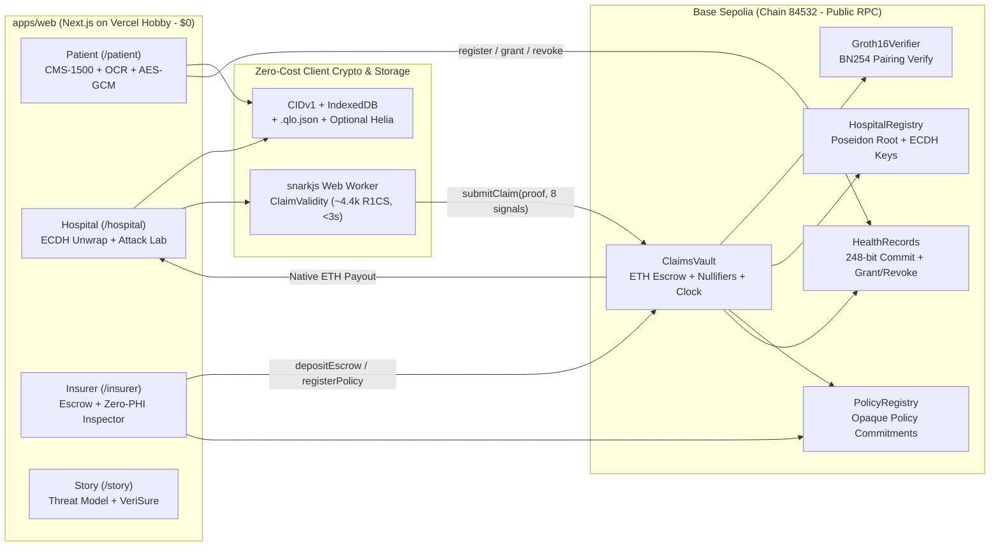

# Qlo — Zero-Knowledge Health Insurance Claims & Patient-Sovereign Records

**Qlo proves health claim eligibility, policy coverage, and cumulative annual caps in zero knowledge on Base Sepolia while keeping medical records patient-owned and AES-256-GCM encrypted—built on a $0, 100% MIT open-source stack.**

---

## 3-Minute Judge Path

> Follow this exact 5-step path (detailed minute-by-minute talk track in [docs/JUDGING_SCRIPT.md](docs/JUDGING_SCRIPT.md)):

1. **Mission Control (`/`):** Connect MetaMask on **Base Sepolia** (`84532`), inspect live verified contract health and `.zkey` SHA-256 integrity, and review the **14–30d EDI Clearinghouse → < 3s Qlo Groth16** benchmark.
2. **Patient Vault (`/patient`):** Load a synthetic CMS-1500 claim (or run 100% browser-local **`tesseract.js` OCR** on a medical bill image) → **Encrypt Locally (AES-256-GCM)** → inspect deterministic **IPFS CIDv1** & **248-bit `recordCommitment`** → Register on-chain & **Grant 10-Min Access** (wraps DEK via ECDH P-256).
3. **Hospital Prover (`/hospital`):** Unwrap DEK & decrypt → generate a real **Groth16 proof in `< 3s`** inside a Web Worker watching all **8 predicates** verify → **Auto-Settle ETH on Base Sepolia**.
4. **Fail-Closed Attack Lab & Revocation (`/hospital` ↔ `/patient`):** Trigger **Replay (`NullifierAlreadyUsed`)**, **Uncovered CPT (`15777`)**, **Expired Policy**, and **Over Annual Cap**; then **Revoke Access** on `/patient` and confirm the hospital is immediately blocked on-chain (`PatientAccessNotActive`).
5. **Insurer Money Shot & Threat Model (`/insurer` & `/story`):** Inspect the **Split-Screen "What the Chain Sees vs. Private Clinical Reality"** live Base Sepolia calldata zero-PHI scanner (`0 PHI bytes found`), plus the STRIDE threat model, `.zkey` integrity check, and competitive comparison on `/story`.

---

## System Architecture

---

## Specification Index

| Document | Purpose |
|---|---|
| [SPEC.md](SPEC.md) | Master specification: Change Healthcare motivation, Full VeriSure parity matrix, 8-point Red-Team Audit log, monorepo tree, 12h roadmap |
| [interfaces/claim-zk.md](interfaces/claim-zk.md) | **FROZEN ZK ABI:** 8 public signals, 12 private inputs, Poseidon formulas, Merkle convention, Circom code, 11-test soundness matrix |
| [docs/CONTRACTS_SPEC.md](docs/CONTRACTS_SPEC.md) | Solidity `0.8.28` + OZ v5 contract specs, role matrix, 13-test Foundry security suite, Sourcify/Etherscan verification |
| [docs/CRYPTO_STORAGE_OCR_SPEC.md](docs/CRYPTO_STORAGE_OCR_SPEC.md) | AES-256-GCM + ECDH P-256 key wrapping, CIDv1 + IndexedDB + `.qlo.json`, CMS-1500 schema & browser `tesseract.js` OCR |
| [docs/UI_UX_DESIGN_SPEC.md](docs/UI_UX_DESIGN_SPEC.md) | Clinical-Ops theme, MIT component stack (`shadcn`, `Origin UI`, `EasyUI`, `Magic UI`, `React Bits`, `Motion Primitives`), 5 route specs |
| [docs/THREAT_MODEL_AND_VERISURE.md](docs/THREAT_MODEL_AND_VERISURE.md) | Trust boundaries, STRIDE matrix, cryptographic honesty disclosures, deep contrast vs. VeriSure |
| [docs/JUDGING_SCRIPT.md](docs/JUDGING_SCRIPT.md) | Timed 3-minute live pitch script, 7-point Base Sepolia acceptance list, free faucets & emergency backup |

---

## Prior Art & Competitive Comparison (vs. VeriSure, ETHDenver 2025)

| Capability | Traditional EDI Clearinghouse | VeriSure (ETHDenver 2025) | Qlo |
|---|---|---|---|
| **Settlement Latency** | 14 – 30+ days | ~2 minutes (AVS + zkVM) | **< 5 seconds** (Web Worker Groth16 + L2) |
| **Claim Intake & OCR** | Centralized PHI honeypot | Gaia AI off-chain OCR | **100% client-side CMS-1500 + `tesseract.js` OCR** |
| **Policy Coverage in ZK** | Manual / opaque adjudication | Deferred as future work | **8 real Groth16 predicates** (CPT tree, expiry, cap, hospital, nullifier, anti-front-run) |
| **Cumulative Annual Limits** | Database state | Not implemented | **Private `annualLimit`** checked against on-chain `policySpent` |
| **Patient Data Sovereignty** | None | None | **AES-256-GCM + ECDH wrapped DEKs** + instant on-chain revoke enforced in `ClaimsVault` |
| **Cash Cost & License** | Enterprise SaaS / BAA fees | AVS/zkVM stack; BUSL-1.1 performer | **$0 / 100% MIT Open Source** |

---

## Verified Base Sepolia Contracts (`deployments/base-sepolia.json`)

> Contract addresses, `zkeySha256`, and verified Sourcify / Basescan links are populated automatically by `contracts/script/DeployBaseSepolia.s.sol` upon Base Sepolia deployment.

| Contract | Role | Address | Verification |
|---|---|---|---|
| `Groth16Verifier` | BN254 pairing check (8 public signals) | *Populated on Base Sepolia deploy* | Sourcify (zero-key) + Basescan |
| `HospitalRegistry` | `Ownable2Step` Poseidon root + ECDH pubkeys | *Populated on Base Sepolia deploy* | Sourcify + Basescan |
| `PolicyRegistry` | Insurer opaque policy commitments | *Populated on Base Sepolia deploy* | Sourcify + Basescan |
| `HealthRecords` | 248-bit commitments, CIDv1, grant/revoke, wrapped DEKs | *Populated on Base Sepolia deploy* | Sourcify + Basescan |
| `ClaimsVault` | `Pausable`, `ReentrancyGuard` ETH escrow & ZK settlement | *Populated on Base Sepolia deploy* | Sourcify + Basescan |

---

## $0 Stack Guarantee

- **Included:** Base Sepolia (`https://sepolia.base.org`), native ETH settlement, Foundry + OpenZeppelin v5 (MIT), Circom 2 + `circomlib` + `snarkjs` + EF PSE Perpetual Powers of Tau (`ppot_0080_13`), Next.js + `wagmi` (MetaMask injected only), WebCrypto + `multiformats` CIDv1 + IndexedDB, `tesseract.js`, MIT UI registries (`shadcn/ui`, `Origin UI`, `EasyUI`, `Magic UI`, `React Bits`, `Motion Primitives`), Vercel Hobby, GitHub Actions, Sourcify.
- **Explicitly Excluded ($0 Discipline):** Pinata, Alchemy paid, Infura, WalletConnect Cloud, Circle USDC, Chainlink oracles, EigenLayer/Othentic, Gaia AI external nodes, RISC0/Bonsai.
