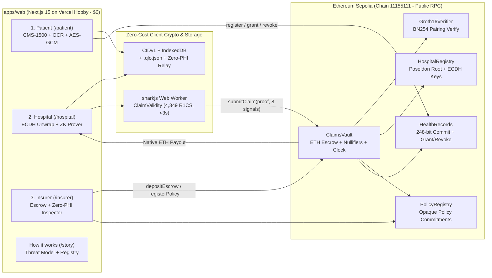

# Qlo — Zero-Knowledge Health Insurance Claims & Patient-Sovereign Records

**Qlo proves health claim eligibility, policy coverage, and cumulative annual caps in zero knowledge on Ethereum Sepolia (`11155111`) while keeping medical records patient-owned and AES-256-GCM encrypted—built on a $0, 100% MIT open-source stack.**

---

## Live Verified Ethereum Sepolia Proof of Execution (`Chain ID 11155111`)

- **Live Groth16 Claim Settlement Tx (0.005 ETH, 574ms prove, 0 PHI bytes in calldata):** [`0xf8cb4e31...aa2ed0`](https://sepolia.etherscan.io/tx/0xf8cb4e31169eac006b4c5dd0a69fa763de7b9ddb79a7cd25419062ead7aa2ed0)
- **Live Record Registration (`HealthRecords` #1):** [`0x742035b9...50494e`](https://sepolia.etherscan.io/tx/0x742035b943904c6bdcde1a6ceeba505efa75b2fccaba2d549860ae5fb350494e)
- **Live Time-Bound Consent Grant (600s + ECDH Wrapped DEK):** [`0x155888e6...c93cb1`](https://sepolia.etherscan.io/tx/0x155888e6d36bb9849b1f9e066d20e4a10902ed618858d1de666dd12ba0c93cb1)
- **Active Insurer Escrow Balance:** `0.0200 ETH` funded on-chain (`paused=false`, `policySpent=0.005 ETH` vs private `0.030 ETH` cap)

---

## 3-Minute Demo Path

> Follow this 3-step clinical flow (detailed minute-by-minute talk track in [docs/JUDGING_SCRIPT.md](docs/JUDGING_SCRIPT.md)):

1. **Overview (`/`):** Connect MetaMask on **Ethereum Sepolia (`11155111`)** via the unified top bar (`1. Patient → 2. Hospital → 3. Insurer | How it works`).
2. **Step 1 — Patient Vault (`/patient`):** Load a synthetic CMS-1500 bill (or run 100% browser-local **`tesseract.js` OCR** on a medical bill image) → **Encrypt Locally (AES-256-GCM)** → inspect deterministic **IPFS CIDv1** & **248-bit `recordCommitment`** → Register on Ethereum Sepolia & **Grant 10-Min Access** (wraps DEK via ECDH P-256) → click **Continue to Step 2: Hospital**.
3. **Step 2 — Hospital Prover (`/hospital`):** Register your browser's one-time hospital ECDH key if prompted → **Unwrap DEK & Decrypt** → generate a real **Groth16 proof in `< 3s`** inside a Web Worker checking all **8 predicates** → **Auto-Settle ETH on Ethereum Sepolia**. Open the collapsed **Advanced Demo Tools** drawer to fire the **5-Attack Fail-Closed Lab** (Replay, Uncovered CPT `15777`, Expired Policy, Over Annual Cap, Post-Revoke) or export **HL7 FHIR R4 / ANSI X12 837P & 835**.
4. **Step 3 — Insurer Zero-PHI Audit (`/insurer`) & Trust Center (`/story`):** Inspect live Ethereum Sepolia settled claims in the **Split-Screen "What the Chain Sees vs. What Stays Private"** calldata scanner (**`0 PHI bytes found`**), manage native ETH escrow, and verify the live browser **`.zkey` SHA-256** digest and STRIDE threat model on `/story`.

---

## System Architecture



---

## Specification Index

| Document | Purpose |
|---|---|
| [SPEC.md](SPEC.md) | Master specification: Change Healthcare motivation, VeriSure parity matrix, 8-point Red-Team Audit log, monorepo tree |
| [interfaces/claim-zk.md](interfaces/claim-zk.md) | **FROZEN ZK ABI:** 8 public signals, 12 private inputs, Poseidon formulas, Merkle convention, Circom code, 11-test soundness matrix |
| [docs/CONTRACTS_SPEC.md](docs/CONTRACTS_SPEC.md) | Solidity `0.8.28` + OZ v5 contract specs, role matrix, 18-test Foundry security & invariant suite, Sourcify/Etherscan verification |
| [docs/CRYPTO_STORAGE_OCR_SPEC.md](docs/CRYPTO_STORAGE_OCR_SPEC.md) | AES-256-GCM + ECDH P-256 key wrapping, CIDv1 + IndexedDB + `.qlo.json`, CMS-1500 schema & browser `tesseract.js` OCR |
| [docs/UI_UX_DESIGN_SPEC.md](docs/UI_UX_DESIGN_SPEC.md) | Clinical-Ops theme, MIT component stack, simplified 3-step UX across all 5 routes |
| [docs/THREAT_MODEL_AND_VERISURE.md](docs/THREAT_MODEL_AND_VERISURE.md) | Trust boundaries, STRIDE matrix, cryptographic honesty disclosures, deep contrast vs. VeriSure |
| [docs/JUDGING_SCRIPT.md](docs/JUDGING_SCRIPT.md) | Timed 3-minute live pitch script, 7-point Ethereum Sepolia acceptance checklist, free faucets & venue fallback |
| [STATUS.md](STATUS.md) | Live deployment addresses, verification ledger, and launch checklist |

---

## Prior Art & Competitive Comparison (vs. VeriSure, ETHDenver 2025)

| Capability | Traditional EDI Clearinghouse | VeriSure (ETHDenver 2025) | Qlo |
|---|---|---|---|
| **Settlement Latency** | 14 – 30+ days | ~2 minutes (AVS + zkVM) | **< 3 seconds** client Groth16 prove + atomic Sepolia ETH payout |
| **Claim Intake & OCR** | Centralized PHI honeypot | Gaia AI off-chain OCR | **100% client-side CMS-1500 + `tesseract.js` OCR** |
| **Policy Coverage in ZK** | Manual / opaque adjudication | Deferred as future work | **8 real Groth16 predicates** (CPT tree, expiry, cap, hospital, nullifier, anti-front-run) |
| **Cumulative Annual Limits** | Database state | Not implemented | **Private `annualLimit`** checked against on-chain `policySpent` |
| **Patient Data Sovereignty** | None | None | **AES-256-GCM + ECDH wrapped DEKs** + instant on-chain revoke enforced in `ClaimsVault` |
| **Cash Cost & License** | Enterprise SaaS / BAA fees | AVS/zkVM stack; BUSL-1.1 performer | **$0 / 100% MIT Open Source** |

---

## Verified Ethereum Sepolia Contracts (`deployments/sepolia.json`, Block `12194573`)

> All 5 contracts were deployed via `scripts/deploy-sepolia.ps1` (`contracts/script/DeploySepolia.s.sol`) and verified **`5 / 5 exact_match`** on Sourcify (zero API keys). Pinned `.zkey` SHA-256: `7f26163076e3dcc5e61175e96fb6ce8a95b36dac8ba27c7e7ee5edcee4771746`.

| Contract | Role | Live Ethereum Sepolia Address | Verification |
|---|---|---|---|
| `Groth16Verifier` | BN254 pairing check (8 public signals) | `0x587FB82b3429d9Be80e23791809A92DAD352D019` | [Sourcify Exact Match](https://repo.sourcify.dev/contracts/full_match/11155111/0x587FB82b3429d9Be80e23791809A92DAD352D019) · [Etherscan](https://sepolia.etherscan.io/address/0x587FB82b3429d9Be80e23791809A92DAD352D019) |
| `HospitalRegistry` | `Ownable2Step` Poseidon root + ECDH pubkeys | `0xCf150397a7416D54c3828ffaC1B808a5C51B563D` | [Sourcify Exact Match](https://repo.sourcify.dev/contracts/full_match/11155111/0xCf150397a7416D54c3828ffaC1B808a5C51B563D) · [Etherscan](https://sepolia.etherscan.io/address/0xCf150397a7416D54c3828ffaC1B808a5C51B563D) |
| `PolicyRegistry` | Insurer opaque policy commitments | `0xc37c6A5e705B9aa9eB2680aBb2A72Ebf9080ebCF` | [Sourcify Exact Match](https://repo.sourcify.dev/contracts/full_match/11155111/0xc37c6A5e705B9aa9eB2680aBb2A72Ebf9080ebCF) · [Etherscan](https://sepolia.etherscan.io/address/0xc37c6A5e705B9aa9eB2680aBb2A72Ebf9080ebCF) |
| `HealthRecords` | 248-bit commitments, CIDv1, grant/revoke, wrapped DEKs | `0x547273d15522AA461af233e5b4d7abb70D0bD8ce` | [Sourcify Exact Match](https://repo.sourcify.dev/contracts/full_match/11155111/0x547273d15522AA461af233e5b4d7abb70D0bD8ce) · [Etherscan](https://sepolia.etherscan.io/address/0x547273d15522AA461af233e5b4d7abb70D0bD8ce) |
| `ClaimsVault` | `Pausable`, `ReentrancyGuard` ETH escrow & ZK settlement | `0xB170D66d32C26168A56516d0aDb464B7762cC559` | [Sourcify Exact Match](https://repo.sourcify.dev/contracts/full_match/11155111/0xB170D66d32C26168A56516d0aDb464B7762cC559) · [Etherscan](https://sepolia.etherscan.io/address/0xB170D66d32C26168A56516d0aDb464B7762cC559) |

---

## Quick Verification Commands

```bash
# Run full automated verification (Circom 11/11, Foundry 18/18, Anvil E2E 5/5, Vitest, Build, E2E + ECC perimeter)
pnpm verify:all

# Verify live Ethereum Sepolia contracts + running frontend routes, CSP, Zero-PHI relay & .zkey SHA-256
node scripts/verify-live.mjs --url http://127.0.0.1:3000
```

---

## $0 Stack Guarantee

- **Included:** Ethereum Sepolia (`https://ethereum-sepolia-rpc.publicnode.com`, `https://1rpc.io/sepolia`, `https://sepolia.gateway.tenderly.co`), native ETH settlement, Foundry + OpenZeppelin v5 (MIT), Circom 2 + `circomlib` + `snarkjs` + EF PSE Perpetual Powers of Tau (`ppot_0080_13`), Next.js 15 + `wagmi` (MetaMask injected only), WebCrypto + `multiformats` CIDv1 + IndexedDB, `tesseract.js`, MIT UI components, Vercel Hobby, GitHub Actions, Sourcify.
- **Explicitly Excluded ($0 Discipline):** Pinata, Alchemy paid, Infura, WalletConnect Cloud, Circle USDC, Chainlink oracles, EigenLayer/Othentic, Gaia AI external nodes, RISC0/Bonsai.
